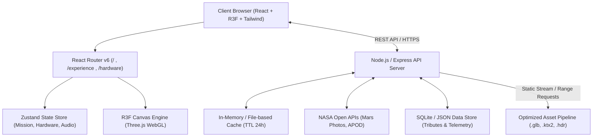

# OPPY'S LAST DANCE — System Architecture Specification
**Document ID:** `PLANKIT-ARCH-01`  
**Version:** `1.0.0`  
**Target:** React 18+ / Vite / TypeScript / React Three Fiber / Node.js + Express  

---

## 1. High-Level Architecture Overview

The system is organized as a high-performance modern full-stack web application with client-side 3D rendering and a lightweight Node.js/TypeScript backend API service.



---

## 2. Directory & Workspace Structure

```text
e:\OPPY/
├── plan-kit/                               # Modular Project Plan Kit
│   ├── 01-SYSTEM-ARCHITECTURE.md
│   ├── 02-UI-UX-SPECIFICATION.md
│   ├── 03-3D-ENGINE-SPECIFICATION.md
│   ├── 04-BACKEND-API-SPECIFICATION.md
│   └── 05-PHASED-EXECUTION-PROMPTS.md
│
├── client/                                 # Frontend SPA (React + TS + Vite)
│   ├── public/
│   │   ├── models/                         # 3D Assets (24883_MER_static.glb, environments)
│   │   ├── textures/                       # PBR textures & equirectangular skyboxes
│   │   └── audio/                          # Pre-rendered UI sound bites
│   ├── src/
│   │   ├── components/
│   │   │   ├── 3d/                         # React Three Fiber components
│   │   │   │   ├── RoverModel.tsx          # PBR Rover with GLSL wheel rotation
│   │   │   │   ├── PhaseEnvironment.tsx    # Dynamic environment loader
│   │   │   │   ├── CadRails.tsx            # Exploded view dashed alignment rails
│   │   │   │   ├── VisionFrustum.tsx       # Pancam stereo FOV cone
│   │   │   │   ├── RockSample.tsx          # Basalt rock + RAT spark particles
│   │   │   │   └── DsnWaves.tsx            # Concentric RF wavefront pulse rings
│   │   │   ├── ui/                         # Clean Grayscale HUD Components
│   │   │   │   ├── Navigation.tsx          # Minimal header route switches
│   │   │   │   ├── TelemetryHUD.tsx        # Physical readouts (voltage, speed, az/el)
│   │   │   │   ├── StoryTimeline.tsx       # 6-phase journey controller
│   │   │   │   ├── ComponentDrawer.tsx     # Hardware deep-dive sidebar
│   │   │   │   └── TributeBoard.tsx        # Visitor guestbook modal
│   │   │   └── shared/
│   │   │       ├── LoadingScreen.tsx       # Shader compilation & GLB download bar
│   │   │       └── AudioSynthesizer.tsx    # Web Audio API ambient wind & motors
│   │   ├── hooks/                          # Custom hooks (useAudio, useTelemetry, useModel)
│   │   ├── stores/                         # Zustand state slices (missionStore, hardwareStore)
│   │   ├── types/                          # TypeScript definitions for mission & telemetry
│   │   ├── pages/                          # Route pages
│   │   │   ├── HomePage.tsx                # Cinematic landing page
│   │   │   ├── ExperiencePage.tsx          # The 6-Phase Complete Journey
│   │   │   └── HardwarePage.tsx            # Interactive 3D Hardware Explorer
│   │   ├── App.tsx                         # App Shell & Router
│   │   └── main.tsx                        # Entry point
│   ├── tailwind.config.js                  # Grayscale design token theme
│   ├── tsconfig.json
│   └── vite.config.ts                      # Vite config with GLTF/GLB chunk handling
│
├── server/                                 # Backend API (Node.js + Express + TS)
│   ├── src/
│   │   ├── controllers/                    # Route controllers (nasa, tributes, telemetry)
│   │   ├── services/                       # NASA API client, SQLite store, cache
│   │   ├── routes/                         # API route declarations (/api/...)
│   │   └── server.ts                       # Express app bootstrap
│   ├── data/                               # Static telemetry JSON & tributes.db
│   ├── tsconfig.json
│   └── package.json
│
└── package.json                            # Monorepo / root management script
```

---

## 3. Technology Stack Justifications

| Layer | Technology | Version | Architectural Justification |
| :--- | :--- | :--- | :--- |
| **Frontend Framework** | React + TypeScript | `^18.3` | Strong typing for 3D vector math, componentized state management, declarative rendering |
| **Build Tooling** | Vite | `^5.4` | Sub-100ms HMR, optimized ESM bundling, zero-overhead asset imports |
| **3D Rendering** | Three.js + R3F (`@react-three/fiber`) | Three `r128+`, R3F `^8.17` | React component lifecycle tied directly to WebGL canvas; automated memory disposal |
| **3D Ecosystem** | `@react-three/drei` | `^9.114` | Pre-built OrbitControls, Environment loaders, Line helpers, and ShaderMaterial helpers |
| **Animation Engine** | GSAP (`gsap`) + R3F Clock | `^3.12` | Smooth camera gliding, HUD fade-ins, and complex cinematic timeline orchestration |
| **State Management**| Zustand | `^4.5` | Zero-boilerplate global store for mission phase indices, exploded view %, and audio |
| **Styling** | Tailwind CSS | `^3.4` | Utility-first grayscale palette, WCAG AA contrast compliance, zero runtime CSS overhead |
| **Backend Runtime** | Node.js + Express (TS) | Node `v20+`, Express `^4.19` | Fast REST API, gzip/brotli static streaming for 11.9MB GLBs, NASA API proxy with cache |
| **Persistence** | SQLite / `better-sqlite3` | `^11.0` | Zero-config embedded relational store for visitor tributes and historical Sol records |

---

## 4. State Management Architecture (Zustand)

```typescript
// client/src/stores/missionStore.ts
interface MissionState {
  currentPhaseIndex: number;
  isAutoplay: boolean;
  playbackSpeed: 1 | 2 | 4;
  environmentDustOpacity: number;
  roverAnimationMode: 'idle' | 'drive' | 'scan' | 'sample' | 'comm';
  setPhase: (index: number) => void;
  nextPhase: () => void;
  prevPhase: () => void;
  setAnimationMode: (mode: MissionState['roverAnimationMode']) => void;
}

// client/src/stores/hardwareStore.ts
interface HardwareState {
  selectedSubsystem: string | null;
  explodedFactor: number; // 0.0 to 1.0
  isExploded: boolean;
  isWireframe: boolean;
  setSelectedSubsystem: (key: string | null) => void;
  setExplodedFactor: (factor: number) => void;
  toggleExploded: () => void;
  toggleWireframe: () => void;
}
```

---

## 5. Network & Caching Strategy

1. **Model & Environment Delivery**:
   - `24883_MER_static.glb` (11.9 MB) served with `Cache-Control: public, max-age=31536000, immutable`.
   - Chunked Range Requests enabled on the Node.js server for low-latency streaming.
2. **NASA API Proxy**:
   - Outbound requests to `api.nasa.gov` are cached server-side in memory for 24 hours to prevent rate-limit exhaustion (429 Too Many Requests).
   - In offline or sandbox environments, the server falls back to pre-bundled JSON fixtures in `server/data/nasa-cache/`.
