# OPPY'S LAST DANCE — 3D Engine & Shader Specification
**Document ID:** `PLANKIT-3D-03`  
**Version:** `1.0.0`  
**Core Technologies:** Three.js `r128+`, `@react-three/fiber`, `@react-three/drei`, GLSL ES 1.00/3.00  

---

## 1. 3D Scene Graph Architecture (R3F)

```mermaid
graph TD
    Canvas["<Canvas> (Three.js WebGLRenderer, ACESFilmic ToneMapping)"]
    Orbit["<OrbitControls> (Damping: 0.05, Polar Limits [0, 88°])"]
    Lights["Lighting Rig (Sun Directional + Soft Shadow, Ambient, Hemisphere)"]
    EnvMap["Environment Map (<Environment> Martian Equirectangular Texture)"]
    
    SceneRoot["<SceneRoot>"]
    
    EnvGroup["<PhaseEnvironment> (Discrete GLTF Loader per Phase)"]
    Env1["Phase 1: Deep Space Launch Rig"]
    Env2["Phase 2: Atmospheric EDL Airbag Crater"]
    Env3["Phase 3: Eagle Crater Bedrock"]
    Env4["Phase 4: Victoria / Endeavour Crater Rim"]
    Env5["Phase 5: Global Dust Storm (Dense Volumetric Fog)"]
    Env6["Phase 6: Twilight Sunset Memorial"]

    RoverGroup["<RoverModel> (Flight Model 24883_MER_static.glb)"]
    Pivots["Subsystem Articulation Pivots"]
    MastGroup["mastPivotGroup (-0.02, 0.713, 0.356)"]
    ArmGroup["armPivotGroup (0.104, 0.464, 0.423)"]
    AntennaGroup["antennaPivotGroup (0.387, 0.814, -0.236)"]
    SuspensionMesh["tex_suspension_n (GPU Wheel Shader)"]

    FXGroup["<MartianFXGroup>"]
    Dust["Dust Plume Particle System (80 pts)"]
    Sparks["RAT Grinding Spark Emitter (35 pts)"]
    Laser["APXS Spectrometer Laser Beam"]
    Frustum["Pancam Stereo Vision Frustum & Reticle"]
    RFWaves["DSN Concentric RF Wavefront Rings"]
    CadRails["Cyan Dashed CAD Guide Rails (LineDashedMaterial)"]

    Canvas --> Orbit
    Canvas --> Lights
    Canvas --> EnvMap
    Canvas --> SceneRoot
    SceneRoot --> EnvGroup
    EnvGroup --> Env1
    EnvGroup --> Env2
    EnvGroup --> Env3
    EnvGroup --> Env4
    EnvGroup --> Env5
    EnvGroup --> Env6
    SceneRoot --> RoverGroup
    RoverGroup --> Pivots
    Pivots --> MastGroup
    Pivots --> ArmGroup
    Pivots --> AntennaGroup
    Pivots --> SuspensionMesh
    SceneRoot --> FXGroup
    FXGroup --> Dust
    FXGroup --> Sparks
    FXGroup --> Laser
    FXGroup --> Frustum
    FXGroup --> RFWaves
    FXGroup --> CadRails
```



---

## 2. Rover Model Loading & Mesh Disassembly

The model file `24883_MER_static.glb` ($11,910,084\text{ bytes}$) consists of a single mesh node with 9 primitives mapped to 9 materials:
- `tex_mast` & `foil_silver`: Pancam Mast Assembly (PMA)
- `tex_panels_n` & `tex_panels2_n`: Triple-junction GaAs solar arrays
- `tex_instruments` & `Silver`: High Gain Antenna (HGA) & instrument deck
- `tex_arm`: Instrument Deployment Device (IDD) 5-DOF robotic arm
- `tex_suspension_n`: Rocker-Bogie mobility mechanism & 6 wheels
- `tex_body_n`: Warm Electronics Box (WEB) core avionics

### Pivot Group Reparenting Matrix (Local Space)

When `GLTFLoader` parses the model, meshes are reparented under dedicated pivot groups to enable natural kinematic articulation without disrupting coordinate spaces:

```typescript
// Subsystem Kinematic Pivots (SI Coordinates in Meters)
const PIVOT_OFFSETS = {
  mast:    new THREE.Vector3(-0.020, 0.713, 0.356),
  arm:     new THREE.Vector3( 0.104, 0.464, 0.423),
  antenna: new THREE.Vector3( 0.387, 0.814, -0.236)
};

// Exploded CAD Displacement Vectors
const EXPLODE_DELTAS = {
  mast:      new THREE.Vector3( 0.00,  0.80,  0.18),
  power:     new THREE.Vector3( 0.00,  0.42, -0.06),
  antenna:   new THREE.Vector3( 0.15,  0.50, -0.40),
  arm:       new THREE.Vector3( 0.00, -0.12,  0.60),
  mobility:  new THREE.Vector3( 0.00, -0.38,  0.00),
  avionics:  new THREE.Vector3( 0.00,  0.00,  0.00) // Central stationary reference datum
};
```

---

## 3. GPU Wheel Rotation GLSL Vertex Shader

Because the 6 wheels in `24883_MER_static.glb` are merged into a single static geometry buffer with the suspension struts, continuous wheel rotation is computed on the GPU via custom GLSL injection:

```glsl
// Injected into tex_suspension_n MeshStandardMaterial via onBeforeCompile
uniform float uWheelAngle;

void rotateWheelAxle(inout vec3 pos, inout vec3 norm, vec3 hubCenter, float angle) {
  float dx = abs(pos.x - hubCenter.x);
  float dyz = length(vec2(pos.y - hubCenter.y, pos.z - hubCenter.z));
  
  // Isolate wheel rim and cleat radius (r < 0.165m, width < 0.14m)
  if (dx < 0.14 && dyz < 0.165) {
    float cy = pos.y - hubCenter.y;
    float cz = pos.z - hubCenter.z;
    float cosA = cos(angle);
    float sinA = sin(angle);
    
    // Rotate coordinates around wheel axle (+X axis)
    pos.y = hubCenter.y + (cy * cosA - cz * sinA);
    pos.z = hubCenter.z + (cy * sinA + cz * cosA);
    
    // Rotate surface normal to preserve accurate PBR highlights
    float ny = norm.y;
    float nz = norm.z;
    norm.y = ny * cosA - nz * sinA;
    norm.z = ny * sinA + nz * cosA;
  }
}

// In <begin_vertex>:
rotateWheelAxle(transformed, transformedNormal, vec3(-0.520, 0.151,  0.605), uWheelAngle); // Front Left
rotateWheelAxle(transformed, transformedNormal, vec3( 0.522, 0.151,  0.605), uWheelAngle); // Front Right
rotateWheelAxle(transformed, transformedNormal, vec3(-0.525, 0.127, -0.065), uWheelAngle); // Mid Left
rotateWheelAxle(transformed, transformedNormal, vec3( 0.525, 0.127, -0.065), uWheelAngle); // Mid Right
rotateWheelAxle(transformed, transformedNormal, vec3(-0.531, 0.140, -0.606), uWheelAngle); // Rear Left
rotateWheelAxle(transformed, transformedNormal, vec3( 0.528, 0.145, -0.606), uWheelAngle); // Rear Right
```

---

## 4. Discrete Environment Loader per Story Phase

```typescript
// client/src/components/3d/PhaseEnvironment.tsx
import React, { Suspense } from 'react';
import { useGLTF } from '@react-three/drei';

const PHASE_ENV_MODELS = [
  '/models/env_phase1_space.glb',
  '/models/env_phase2_edl.glb',
  '/models/env_phase3_eagle_crater.glb',
  '/models/env_phase4_endurance_rim.glb',
  '/models/env_phase5_dust_storm.glb',
  '/models/env_phase6_twilight.glb'
];

export const PhaseEnvironment: React.FC<{ phaseIndex: number }> = ({ phaseIndex }) => {
  const modelUrl = PHASE_ENV_MODELS[phaseIndex] || PHASE_ENV_MODELS[2];
  const { scene } = useGLTF(modelUrl);
  return (
    <Suspense fallback={<DefaultMartianTerrain />}>
      <primitive object={scene} receiveShadow />
    </Suspense>
  );
};
```

---

## 5. Performance Budgets & Optimization Directives

- **Draw Calls:** Maintained below $35\text{ draw calls/frame}$ through texture atlasing and shared material instancing.
- **Triangle Budget:** Target $< 250,000\text{ triangles}$ total in any single viewport phase.
- **Texture Compacting:** Models use compressed textures (PNG/WebP with standard 2048x2048 normal and diffuse maps).
- **Tone Mapping:** `THREE.ACESFilmicToneMapping` with exposure $1.15$ to emulate real Martian photographic contrast.
