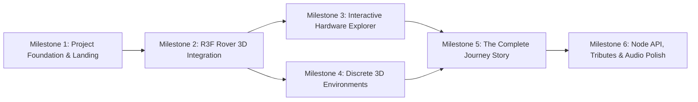

# OPPY'S LAST DANCE — Phased Execution Prompts & Roadmap
**Document ID:** `PLANKIT-PROMPTS-05`  
**Version:** `1.0.0`  
**Purpose:** Standalone, copy-pasteable execution prompts for each milestone of the project.

---

## Roadmap Overview



---

## Milestone 1 — Project Foundation & Landing Page

### Objective
Scaffold the React + TypeScript + Vite project, configure Tailwind CSS with grayscale tokens, install React Router v6 and Zustand, and build the minimal cinematic landing page with exactly two primary options (`WATCH THE EXPERIENCE` and `UNDERSTAND THE HARDWARE`).

### Files to Create / Modify
- `client/package.json`
- `client/vite.config.ts`
- `client/tailwind.config.js`
- `client/src/index.css`
- `client/src/App.tsx`
- `client/src/pages/HomePage.tsx`
- `client/src/components/ui/Navigation.tsx`

### Developer Execution Prompt (Milestone 1)

```markdown
You are implementing Milestone 1 of the "OPPY'S LAST DANCE" project.

TASK:
1. Initialize a clean Vite + React + TypeScript application in `client/` if not present.
2. Install dependencies:
   `npm install react-router-dom zustand lucide-react clsx tailwind-merge`
   `npm install -D tailwindcss postcss autoprefixer @types/node`
3. Configure `tailwind.config.js` with the official grayscale design system:
   - Root background: #101113
   - Elevated background: #181A1D
   - Card/Panel surface: #22252A
   - Borders: #34383E / #4B5058
   - Text colors: #F1F1F1 (primary), #A1A5AA (secondary), #737980 (muted)
   - Accent cyan: #38bdf8
   - Typography: Poppins (imported via Google Fonts in index.html)
4. Implement `client/src/pages/HomePage.tsx`:
   - Title: "OPPY'S LAST DANCE" (Display Bold tracking-tight).
   - Subtitle: "Designed to last 90 days. It explored Mars for nearly 15 years. This is the story of the little rover that changed how humanity sees the Red Planet."
   - EXACTLY two primary action buttons:
     1. "WATCH THE EXPERIENCE" -> navigates to `/experience`
     2. "UNDERSTAND THE HARDWARE" -> navigates to `/hardware`
   - Strict constraint: NO blogs, NO news feeds, NO feature cards, NO superfluous navigation links.
   - Minimalist bottom telemetry bar: `MERIDIANI PLANUM | LAUNCH: JUL 7, 2003 | DISTANCE: 45.16 KM`.
5. Implement `client/src/App.tsx` with React Router routes for `/`, `/experience`, and `/hardware`.
6. Verify locally: Run `npm run dev` and ensure the landing page loads cleanly with zero console warnings.
```

---

## Milestone 2 — 3D Rover Model Integration

### Objective
Integrate Three.js, React Three Fiber (`@react-three/fiber`), and Drei (`@react-three/drei`). Load the 1:1 scale Opportunity flight model (`24883_MER_static.glb`), set up ACESFilmic tone mapping, PCF soft shadows, and inject the GPU GLSL wheel rotation shader.

### Files to Create / Modify
- `client/src/components/3d/RoverCanvas.tsx`
- `client/src/components/3d/RoverModel.tsx`
- `client/src/components/3d/MartianLighting.tsx`
- `client/src/components/3d/GroundRings.tsx`
- `client/src/shaders/wheelShader.ts`

### Developer Execution Prompt (Milestone 2)

```markdown
You are implementing Milestone 2 of "OPPY'S LAST DANCE".

TASK:
1. Install 3D packages in `client/`:
   `npm install three @react-three/fiber @react-three/drei`
   `npm install -D @types/three`
2. Place `24883_MER_static.glb` in `client/public/models/24883_MER_static.glb`.
3. Create `client/src/components/3d/RoverCanvas.tsx`:
   - Canvas configured with `gl={{ antialias: true, toneMapping: THREE.ACESFilmicToneMapping, toneMappingExposure: 1.15 }}`.
   - OrbitControls with damping (0.05), maxPolarAngle (88° to prevent subsurface clipping), and smooth target centering at (0, 0.65, 0).
4. Create `client/src/components/3d/RoverModel.tsx`:
   - Load `24883_MER_static.glb` using `useGLTF`.
   - Separate primitives and parent them under kinematic pivot groups:
     * mastPivotGroup at (-0.020, 0.713, 0.356)
     * armPivotGroup at (0.104, 0.464, 0.423)
     * antennaPivotGroup at (0.387, 0.814, -0.236)
   - Inject the GLSL wheel rotation shader on `tex_suspension_n` via `material.onBeforeCompile`.
   - Rotate all 6 wheel clusters around axle centers (X: ±0.522, Y: 0.14, Z: 0.605 / -0.065 / -0.606) using uniform `uWheelAngle`.
5. Add soft directional Martian sunlight (intensity 2.8, position [4.5, 7.5, 3.8]) with shadow mapping (bias -0.0003), ambient fill, and subtle range reticles.
6. Verify: The rover must render at accurate scale (2.28m x 1.58m x 1.65m), cast soft shadows, and rotate smoothly at 60 fps without WebGL shader compilation errors.
```

---

## Milestone 3 — Interactive 3D Hardware Explorer (`/hardware`)

### Objective
Build the dedicated interactive engineering museum experience at route `/hardware`. Support clickable component selection, camera auto-focus, emissive pulse highlighting, continuous exploded CAD view (0% to 100%), dashed cyan guide rails, and engineering-to-discovery technical cards.

### Files to Create / Modify
- `client/src/pages/HardwarePage.tsx`
- `client/src/components/hardware/SubsystemDrawer.tsx`
- `client/src/components/hardware/ExplodedController.tsx`
- `client/src/components/3d/CadGuideRails.tsx`
- `client/src/stores/hardwareStore.ts`
- `client/src/data/subsystems.json`

### Developer Execution Prompt (Milestone 3)

```markdown
You are implementing Milestone 3 of "OPPY'S LAST DANCE".

TASK:
1. Create `client/src/data/subsystems.json` with verified NASA specifications for all 6 subsystems:
   - 01. Pancam Mast Assembly (PMA)
   - 02. GaAs Solar Array Wings
   - 03. Rocker-Bogie Mobility System
   - 04. IDD 5-DOF Robotic Arm (RAT, APXS, Mössbauer, Microscopic Imager)
   - 05. High-Gain Steerable Dish (HGA)
   - 06. RAD6000 Warm Electronics Box (WEB)
   Include for each: mass (kg), operating voltage, resolution/bandwidth, operating temp, primary function, and "Engineering-to-Discovery Connection".
2. Create `client/src/stores/hardwareStore.ts` (Zustand):
   - State: `selectedSubsystem`, `explodedFactor` (0.0 to 1.0), `isWireframe`, `isAutoOrbit`.
3. Implement Exploded CAD View logic in `RoverModel.tsx`:
   - Displace subsystems linearly according to `explodedFactor * delta`:
     * Mast: (0.0, +0.80, +0.18)m
     * Power: (0.0, +0.42, -0.06)m
     * Antenna: (+0.15, +0.50, -0.40)m
     * Arm: (0.0, -0.12, +0.60)m
     * Mobility: (0.0, -0.38, 0.0)m
     * Avionics: (0.0, 0.0, 0.0)m (central stationary reference datum)
4. Implement `client/src/components/3d/CadGuideRails.tsx`:
   - Render `THREE.LineDashedMaterial` cyan guide traces (#38bdf8) connecting separated assemblies to their chassis mounting anchors. Dynamic opacity: `0.75 * explodedFactor`.
5. Implement `client/src/components/hardware/SubsystemDrawer.tsx`:
   - Subsystem selector chips with keyboard navigation (1-6).
   - Technical detail card highlighting the "Engineering-to-Discovery Connection" (e.g. APXS -> Jarosite discovery -> proving ancient liquid water).
   - Exploded slider [0% - 100%] and one-click Assemble/Explode button.
6. Verify: Clicking any subsystem smoothly glides the camera to focus on it, pulses its material with an emissive highlight, and updates technical telemetry.
```

---

## Milestone 4 — Discrete 3D Martian Environments

### Objective
Create and integrate distinct 3D environmental scenes for the 6 story phases, incorporating atmospheric fog transitions, sky lighting changes, dust storm darkening, and terrain elements.

### Files to Create / Modify
- `client/src/components/3d/PhaseEnvironment.tsx`
- `client/src/components/3d/AtmosphereManager.tsx`
- `client/src/components/3d/MartianTerrain.tsx`
- `client/public/models/environments/`

### Developer Execution Prompt (Milestone 4)

```markdown
You are implementing Milestone 4 of "OPPY'S LAST DANCE".

TASK:
1. Implement `client/src/components/3d/PhaseEnvironment.tsx` to dynamically load distinct GLTF environment models per story phase:
   - Phase 1: Deep Space Launch trajectory (dark starfield, high-contrast sunlight).
   - Phase 2: Atmospheric EDL Airbag touchdown crater (parachute shroud & airbag imprint).
   - Phase 3: Eagle Crater Bedrock (layered outcrop rock formations, hematite blueberries).
   - Phase 4: Victoria / Endeavour Crater Rim (expansive rocky panoramic rim, traverse wheel tracks).
   - Phase 5: The Final Storm (2018 global dust storm: dense volumetric atmospheric fog, solar insolation dropped by 95%).
   - Phase 6: The Last Dance (subdued twilight Martian sunset, peaceful memorial resting site).
2. Implement `client/src/components/3d/AtmosphereManager.tsx`:
   - Dynamic fog density: `THREE.FogExp2` with density interpolating from 0.005 (clear) up to 0.12 (dust storm).
   - Skybox color gradient transitions: Deep Space (#050508) -> Mars Midday (#c86a3d) -> Dust Storm (#3a1e12) -> Twilight (#1a100b).
3. Connect environment state to `missionStore.ts` so switching phases triggers a smooth 1.2-second cross-dissolve between environments.
4. Provide a procedural terrain fallback (`MartianTerrain.tsx`) so the application remains 100% functional even if external GLTF environment models are loading or unavailable.
5. Verify: Test transitioning between all 6 phases and verify that lighting, fog, and terrain update accurately without frame drops or memory leaks.
```

---

## Milestone 5 — The Complete Journey Storyline (`/experience`)

### Objective
Build the immersive story-driven mission experience at route `/experience`. Integrate the 6 sequential mission phases, non-intrusive floating glass story panels, timeline scrubber, visual props (rock sample, vision cone, RF waves), and audio-visual synchronization.

### Files to Create / Modify
- `client/src/pages/ExperiencePage.tsx`
- `client/src/components/story/StoryOverlay.tsx`
- `client/src/components/story/PhaseTimeline.tsx`
- `client/src/components/3d/VisualProps.tsx`
- `client/src/stores/missionStore.ts`
- `client/src/data/missionPhases.json`

### Developer Execution Prompt (Milestone 5)

```markdown
You are implementing Milestone 5 of "OPPY'S LAST DANCE".

TASK:
1. Create `client/src/data/missionPhases.json` with verified historical mission logs for all 6 phases:
   - Phase 01: The Beginning (2003) — Preparation, twin rover rationale, launch.
   - Phase 02: Arrival on Mars (Jan 25, 2004) — EDL airbag landing in Eagle Crater.
   - Phase 03: The First Discoveries (2004) — Hematite spherules, jarosite, ancient water.
   - Phase 04: Beyond Expectations (2004-2017) — 45.16 km traverse, Endurance/Victoria/Endeavour craters.
   - Phase 05: The Final Storm (2018) — Global dust storm, tau > 10.8, power loss.
   - Phase 06: The Last Dance (Feb 13, 2019) — Mission completion, legacy, tribute.
2. Implement `client/src/components/story/StoryOverlay.tsx`:
   - Non-intrusive floating glass panel positioned at bottom-left (`bg-[#0c0d0f]/85 backdrop-blur-md`).
   - Phase indicator: "PHASE // 03 · THE FIRST DISCOVERIES (2004)".
   - Narrative text and concise "Science Telemetry" badge.
   - Must NOT obstruct the 3D rover model in the viewport.
3. Implement `client/src/components/story/PhaseTimeline.tsx`:
   - Bottom scrubber with milestone nodes (1 through 6).
   - Previous (`<`) and Next (`>`) navigation with keyboard shortcut bindings (Left/Right arrows).
   - Play/Pause automated progression toggle and speed selector (1X, 2X, 4X).
4. Implement `client/src/components/3d/VisualProps.tsx`:
   - In Phase 3 (Discoveries): Render Martian basalt rock outcrop + APXS laser beam.
   - In Phase 4 (Traverse): Render rolling wheels, rocker-bogie pitch/roll, and dust plumes.
   - In Phase 5 (Storm): Accumulate brown dust overlay on solar array textures.
   - In Phase 6 (Tribute): Low camera angle looking up at Opportunity resting beneath the Martian sky.
5. Verify: Navigate through all 6 phases; verify that camera transitions, narrative cards, visual props, and environments update in strict synchronization.
```

---

## Milestone 6 — Backend API, Community Tributes & Audio Polish

### Objective
Build the Node.js/TypeScript backend API service, integrate the NASA Open API caching proxy, implement the community Tribute Guestbook ("Leave a message for Oppy"), add the Web Audio API Martian synthesizer, and execute end-to-end performance verification.

### Files to Create / Modify
- `server/package.json`
- `server/src/server.ts`
- `server/src/routes/api.ts`
- `server/src/services/nasaService.ts`
- `server/src/services/tributeService.ts`
- `client/src/components/shared/TributeModal.tsx`
- `client/src/hooks/useWebAudio.ts`

### Developer Execution Prompt (Milestone 6)

```markdown
You are implementing Milestone 6 of "OPPY'S LAST DANCE".

TASK:
1. Initialize the backend in `server/`:
   `npm init -y`
   `npm install express cors dotenv better-sqlite3 axios compression`
   `npm install -D typescript tsx @types/express @types/cors @types/better-sqlite3 @types/node`
2. Implement `server/src/services/tributeService.ts`:
   - SQLite table `tributes` (id, visitor_name, location, message, created_at, is_approved).
   - Endpoints: `GET /api/tributes` (paginated, latest first) and `POST /api/tributes` (rate-limited, sanitized).
3. Implement `server/src/services/nasaService.ts`:
   - Proxy queries to `api.nasa.gov/mars-photos/api/v1/rovers/opportunity/photos` with 24-hour in-memory cache and offline JSON fallback.
4. Implement `client/src/components/shared/TributeModal.tsx`:
   - Clean grayscale modal allowing visitors to read and submit tributes to Opportunity ("My battery is low and it's getting dark").
5. Implement `client/src/hooks/useWebAudio.ts`:
   - Procedural Martian wind noise buffer with 140 Hz resonant low-pass filter and 0.18 Hz gust LFO.
   - Subsystem sound effects: drive rumble (52 Hz), stepper motor chirps (2200 Hz), RAT grinding (320 Hz), DSN packet sine chimes (1420 Hz).
   - Audio toggle control in navigation header with mute memory in localStorage.
6. Verification & Production Build:
   - Build client: `npm run build` in `client/` (ensure bundle size < 500 KB gzip without 3D models).
   - Build server: `npm run build` in `server/`.
   - Run end-to-end audit: Verify lighthouse performance score > 85, zero accessibility contrast errors, and flawless 3D rendering.
```
